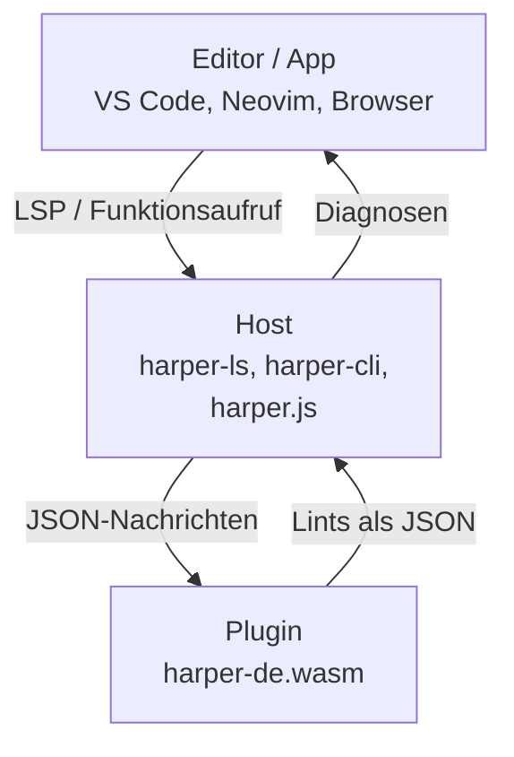

# 1. Überblick

[← Start](README.md) · [Weiter: Die Schnittstelle →](02-schnittstelle.md)

## Das Problem

Auf dem älteren Branch `feature/german-language-support` steckten
Deutsch, Portugiesisch, Slowakisch und Polnisch direkt in
`harper-core`. Folgen (aus Issue [#24]):

- Jede Sprache machte jedes Binary und jede `.wasm` größer. Allein
  das deutsche Wörterbuch hat 6 MB Quelltext.
- Der Diff gegen `master` war riesig (375 Dateien). Kaum zu prüfen,
  kaum upstream anzubieten.
- Jede weitere Sprache hätte das verschärft.

Ziel: Harper bleibt schlank und englisch. Jede andere Sprache wird
nachinstalliert und lebt in einem eigenen Repo.

## Die Idee in einem Satz

> Eine Sprache ist eine einzelne Datei `harper-<id>.wasm`.

Beispiel: `harper-de.wasm`. Darin steckt ein eigenes, auf Deutsch
zugeschnittenes Harper: Wörterbuch, Regeln, Spracherkennung.

Die Datei hat **keine Importe**. Sie kann weder Dateien lesen noch
ins Netz. Sie bekommt Text hinein und gibt Lints heraus. Sonst nichts.
Dieselbe Datei läuft überall.

## Das Bild im Kopf

Drei Schichten, senkrecht:



- Der **Editor** weiß nichts von Plugins. Er spricht LSP mit
  `harper-ls` wie immer.
- Der **Host** entscheidet, welche Sprache gilt, lädt das Plugin und
  übersetzt die Antwort zurück in das, was der Editor versteht.
- Das **Plugin** lintet nur. Es kennt weder Editor noch Dateien.

## Wer ist Host?

Zwei Familien, ein Vertrag:

```
Rust-Hosts           TypeScript-Hosts
─────────────        ────────────────
harper-ls            harper.js
harper-cli           Obsidian
 │                   Chrome/Firefox
 └ wasmtime          └ WebAssembly
   (Kapitel 3)         (Kapitel 9)
```

Beide sprechen mit dem Plugin genau dieselbe JSON-Sprache
([Kapitel 2](02-schnittstelle.md)).

## Welche Teile gibt es?

Im Repo [harper][fork]:

- `harper-plugin-api`: der Vertrag. Typen, Trait, Makro.
  Wird vom Plugin **und** vom Host benutzt.
- `harper-plugin-host`: lädt und startet ein Plugin mit wasmtime.
  Nur für Rust-Hosts.
- `harper-ls/src/plugins.rs` und `backend.rs`: Anbindung an den
  Language Server.
- `harper-cli/src/plugin.rs`: Anbindung an das CLI.
- `packages/harper.js/src/PluginLinter.ts`: dasselbe in TypeScript.
- kleine Haken in `harper-core` ([Kapitel 7](07-core-haken.md)).

Im Repo [harper-german]:

- die deutsche Sprache selbst, als Rust-Crate, das zu
  `wasm32-unknown-unknown` kompiliert wird.

## Warum diese Entscheidungen?

**Warum WebAssembly?** Eine Datei für alle Plattformen. Sandbox
gratis: ohne Importe kann das Plugin nichts anstellen. Im Browser
ist es ohnehin die einzige Option.

**Warum JSON?** Einfach, in Rust und TypeScript gleich lesbar, leicht
zu debuggen. Der Preis sind Kopieren und Parsen. Gemessen (Spike,
Issue #14): erster Aufruf 1,17× so langsam wie nativ, weitere
Aufrufe 1,5×.

**Warum ein eigener Lint-Typ (`PluginLint`)?** `harper_core::Lint`
darf sich ändern, ohne alte Plugins zu brechen. Der Host wandelt um.

**Warum gehört das Wörterbuch ins Plugin?** Ein Host mit Plugin für
Deutsch muss nichts über deutsche Grammatik wissen. Er kennt nicht
einmal den Namen der Sprache: das Plugin sagt selbst, auf welche
Namen es hört (`aliases`).

## Was bleibt in harper-core?

Nur sprachneutrale Haken. Kein Wort Deutsch im Kern. Englisch
ändert sich nicht. Details in [Kapitel 7](07-core-haken.md).

## Merke

1. Sprache = eine `.wasm`-Datei ohne Importe.
2. Host und Plugin reden JSON über vier Funktionen.
3. Der Host übersetzt, das Plugin lintet.
4. Der Kern von Harper bleibt englisch und bekommt nur neutrale Haken.

[← Start](README.md) · [Weiter: Die Schnittstelle →](02-schnittstelle.md)

[#24]: https://github.com/Dronakurl/harper/issues/24
[fork]: https://github.com/Dronakurl/harper
[harper-german]: https://github.com/Dronakurl/harper-german
