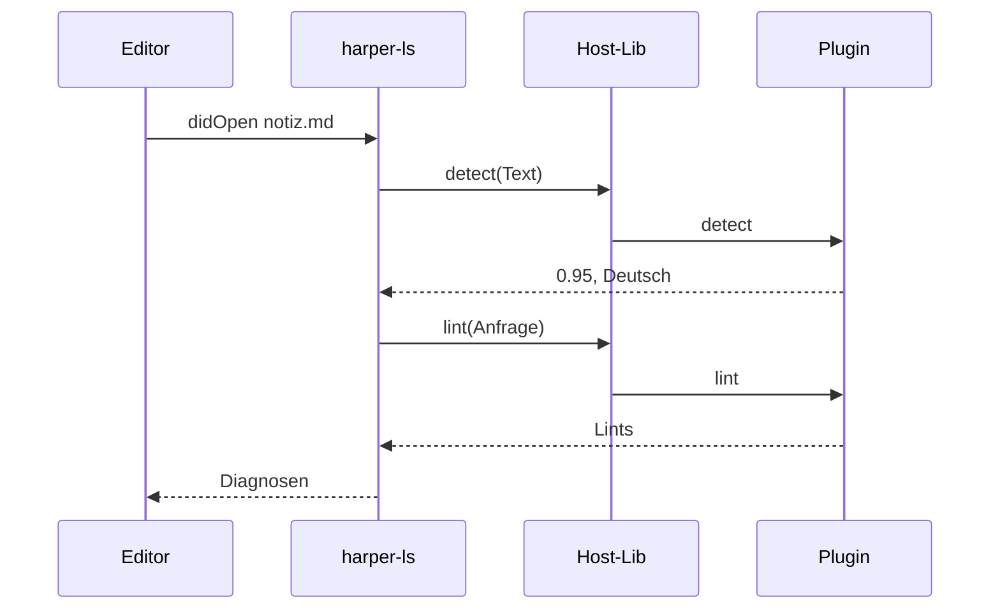

# 4. Ein Lint von A bis Z

[← Der Host](03-host.md) · [Weiter: harper-ls im Detail →](05-harper-ls.md)

Hier setzt sich alles zusammen. Wir verfolgen **einen Satz** durch den
ganzen Stack, mit `harper-ls` als Host.

Ausgangslage: In VS Code ist `notiz.md` offen. Darin steht (ab zehn
Wörtern, dazu gleich mehr):

> Ich habe gestern einen langen Spaziergang gemacht und dabei
> ein Tset gefunden.

`harper-de.wasm` liegt in `~/.config/harper/plugins/`. Die Einstellung
`language` steht auf dem Standard `"auto"`.

## Die Stationen



Jetzt jede Station mit Code.

## Station 1: Der Editor meldet das Dokument

VS Code schickt `textDocument/didOpen`. `harper-ls` landet in
[`update_document`][ud] in `backend.rs`. Das ist die Zentrale: sie
läuft bei jedem Öffnen und jeder Änderung.

Sie liest zuerst die Konfiguration (Sprache, Plugin-Ordner, Dialekt,
Regelschalter) und kopiert sie, damit das Schloss nicht gehalten
wird.

## Station 2: Welche Sprache?

[`choose_language`][cl] (in `plugins.rs`) entscheidet, siehe
[Kapitel 5](05-harper-ls.md):

- `language = "en"`: Englisch, fertig.
- `language = "de"` o. ä.: diese Sprache.
- `language = "auto"`: **Erkennung**.

Bei `auto` gilt: Der Text muss Prosa sein (Markdown, Klartext, …) und
mindestens zehn Wörter haben ([`MIN_WORDS…`][min]). Sonst bleibt die
vorige Sprache, beim ersten Mal Englisch.

Die Erkennung ist [`PluginRegistry::detect`][det]:

1. Alle `*.wasm` im Plugin-Ordner finden (`discover`).
2. Jedes Plugin bei Bedarf laden ([`load`][load], mit Cache).
3. `detect` schicken. Dank der faulen Erzeugung baut das **kein**
   Wörterbuch.
4. Wer mindestens 0,5 meldet, ist im Rennen; der Sicherste gewinnt.

Ergebnis hier: `"de"`.

## Station 3: Nutzerwörter einsammeln

[`collect_user_words`][cuw]: liest drei Wörterbuch-Dateien **dieser
Sprache**:

- Nutzer (`dictionary-de.txt`)
- Workspace (`…-de`)
- Datei (eigenes Verzeichnis `file_dictionaries-de`)

Daraus wird eine sortierte, duplikatfreie Liste. Für Quellcode kommen
noch Bezeichner aus dem Code dazu (damit `tokio_runtime` im Kommentar
kein Rechtschreibfehler ist). Ausführlich in
[Kapitel 8](08-woerterbuecher.md).

## Station 4: Den Plugin-Linter bauen

[`linter_for`][lf] (Registry): lädt das Plugin (aus dem Speicher, wenn
schon geladen), wandelt die Regelkonfiguration in eine
`PluginConfig` um und liefert einen [`PluginLinter`][pl]:

```
PluginLinter
 ├ plugin      (geteilt, Arc)
 ├ format      "markdown"
 ├ config      Regel → an/aus
 ├ user_words  die Liste aus Station 3
 └ regions     None (ganzes Dokument)
```

Er landet in `DocumentState.plugin`
([`document_state.rs`][ds]). Wenn dieses Feld gesetzt ist, **ersetzt
es** den englischen `LintGroup`. Für Plugin-Dokumente wird der
englische Linter gar nicht erst gebaut ([`is_english`][ie]).

Das Dokument selbst wird weiterhin von Harpers Parser gelesen, damit
Spans, Positionen und `ignored_lints` wie gewohnt funktionieren.

## Station 5: Diagnosen anfordern

Der Editor will Diagnosen. [`generate_diagnostics`][gd] sieht das
`plugin`-Feld und ruft [`organized_lints`][ol].

Dort entsteht die Anfrage:

```rust
let mut req = LintRequest::plain(text);
req.user_words = Some(self.user_words.clone());
req.format = self.format.to_owned();
req.config = Some(self.config.clone());
```

Bei Quellcode kommen noch `regions` dazu (die Kommentare).

## Station 6: Über die Grenze

`self.plugin.lint(&req)` ist [`LoadedPlugin::lint`][hl] aus
Kapitel 3:

1. Anfrage in JSON.
2. Schloss nehmen.
3. `alloc`, schreiben, `call`.
4. **Im Plugin:** [`dispatch`][dp] liest die Anfrage; beim ersten Mal
   baut `P::new()` das Wörterbuch (Sekunden), danach nicht mehr.

## Station 7: Im deutschen Plugin

[`German::lint`][gl] (Repo harper-german):

1. `req.user_words` da? Dann [`use_words`][uw]: nur wenn die Liste
   sich geändert hat, wird das Wörterbuch neu zusammengesetzt und die
   Regeln neu gebaut.
2. `req.config` da? Regeln an/aus schalten.
3. Ganzes Dokument oder nur `regions` → [`lint_chars`][lc]:
   - passenden Parser wählen (`PlainGerman`, deutsches Markdown, …)
   - `Document` bauen
   - `group.organized_lints(&document)` laufen lassen
   - Überlappungen entfernen
   - jeden Lint mit [`lint_to_plugin`][l2p] in einen `PluginLint`
     verwandeln, Offset aufaddieren

Hier erscheint `GermanSpellCheck` mit: „Tset" → Vorschlag „Test".

## Station 8: Zurück

Die Antwort ist JSON. Der Host liest sie als `Vec<PluginLint>`
und der `PluginLinter` sortiert sie nach `rule` in eine Map und
wandelt sie mit [`plugin_to_lint`][p2l] in echte `Lint`s.

Wieder in `generate_diagnostics`: `ignored_lints` entfernen,
Positionen für den Editor umrechnen, Schweregrad setzen. Der Editor
zeigt die Wellenlinie.

## Station 9: Quick-Fix

Klickt jemand auf die Lampe, ruft der Editor Code-Aktionen ab.
[`generate_code_actions`][gca] **lintet dafür noch einmal** (gleiche
Anfrage wie in Station 5) und baut daraus „Durch Test ersetzen" sowie
die Wörterbuch-Aktionen. Die Befehle `HarperAddToUserDict` und
`HarperAddToFileDict` ([`backend.rs`][cmd]) schreiben das Wort in die
Wörterbuch-Datei der **Sprache des Dokuments** und rufen
`update_document_from_file` auf. Der Ablauf beginnt von vorn, jetzt
mit einem Wort mehr in `user_words`.

## Dasselbe im CLI

`harper-cli lint --language de notiz.md` macht dieselbe Reise, aber
ohne Editor und ohne Erkennung (außer mit `--language auto`). Das
Zwischenstück ist [`lint_engine.rs`][le], siehe
[Kapitel 6](06-harper-cli.md).

## Merke

1. Alles beginnt in `update_document`: Sprache wählen → Wörter
   sammeln → Plugin-Linter bauen.
2. Der `PluginLinter` hält alles, was eine Anfrage braucht.
3. Am Plugin kommt eine Anfrage an, **die für sich allein
   vollständig ist** (Text, Format, Konfiguration, Wörter).
4. Rückweg: `PluginLint` → `Lint` → Diagnose.

[← Der Host](03-host.md) · [Weiter: harper-ls im Detail →](05-harper-ls.md)

[ud]: https://github.com/Dronakurl/harper/blob/feature/language-plugins/harper-ls/src/backend.rs
[cl]: https://github.com/Dronakurl/harper/blob/feature/language-plugins/harper-ls/src/plugins.rs
[min]: https://github.com/Dronakurl/harper/blob/feature/language-plugins/harper-ls/src/plugins.rs
[det]: https://github.com/Dronakurl/harper/blob/feature/language-plugins/harper-ls/src/plugins.rs
[load]: https://github.com/Dronakurl/harper/blob/feature/language-plugins/harper-ls/src/plugins.rs
[cuw]: https://github.com/Dronakurl/harper/blob/feature/language-plugins/harper-ls/src/backend.rs
[lf]: https://github.com/Dronakurl/harper/blob/feature/language-plugins/harper-ls/src/plugins.rs
[pl]: https://github.com/Dronakurl/harper/blob/feature/language-plugins/harper-ls/src/plugins.rs
[ds]: https://github.com/Dronakurl/harper/blob/feature/language-plugins/harper-ls/src/document_state.rs
[ie]: https://github.com/Dronakurl/harper/blob/feature/language-plugins/harper-ls/src/backend.rs
[gd]: https://github.com/Dronakurl/harper/blob/feature/language-plugins/harper-ls/src/document_state.rs
[ol]: https://github.com/Dronakurl/harper/blob/feature/language-plugins/harper-ls/src/plugins.rs
[hl]: https://github.com/Dronakurl/harper/blob/feature/language-plugins/harper-plugin-host/src/plugin.rs
[dp]: https://github.com/Dronakurl/harper/blob/feature/language-plugins/harper-plugin-api/src/dispatch.rs
[gl]: https://github.com/Dronakurl/harper-german/blob/main/src/plugin.rs
[uw]: https://github.com/Dronakurl/harper-german/blob/main/src/plugin.rs
[lc]: https://github.com/Dronakurl/harper-german/blob/main/src/plugin.rs
[l2p]: https://github.com/Dronakurl/harper/blob/feature/language-plugins/harper-plugin-api/src/convert.rs
[p2l]: https://github.com/Dronakurl/harper/blob/feature/language-plugins/harper-plugin-api/src/convert.rs
[gca]: https://github.com/Dronakurl/harper/blob/feature/language-plugins/harper-ls/src/document_state.rs
[cmd]: https://github.com/Dronakurl/harper/blob/feature/language-plugins/harper-ls/src/backend.rs
[le]: https://github.com/Dronakurl/harper/blob/feature/language-plugins/harper-cli/src/lint_engine.rs
